<div align="center">

<h1>🌡️ Refresca · Serviço de previsão</h1>

<p><b>Alertas de calor extremo e pontos de água e sombra<br>para trabalhadores de rua da Vila Mariana</b></p>

<p>
  
  
  
  
  
  
</p>

<p><sub>Global Solution 2026.2 · FIAP · Engenharia de Software · 3º ano de Fev<br>
Disciplina: <b>Arquitetura Orientada a Serviços (SOA) e Web Services</b></sub></p>

<p>
  <a href="#-ficha-da-citizentech">Ficha</a> ·
  <a href="#-esta-parte-da-refresca">Esta parte</a> ·
  <a href="#-arquitetura">Arquitetura</a> ·
  <a href="#-contratos-entre-as-partes">Contratos</a> ·
  <a href="#-como-rodar">Como rodar</a> ·
  <a href="#-documentação-dos-endpoints">Swagger</a> ·
  <a href="#-testes">Testes</a> ·
  <a href="#-evidências">Evidências</a> ·
  <a href="#-integrantes">Integrantes</a>
</p>

</div>

> Parte da CitizenTech **Refresca**, da Global Solution 2026.2 (FIAP, Engenharia de Software, 3º ano de Fev).
> Alertas de calor extremo e pontos de água e sombra para trabalhadores de rua da Vila Mariana.

---

## 📋 Ficha da CitizenTech

| Campo | Conteúdo |
| --- | --- |
| **Nome** | Refresca |
| **Cidade e bairro** | São Paulo, Vila Mariana |
| **Cidadão beneficiado** | Trabalhador de rua: ambulante, entregador, gari, vendedor de banca |
| **Problema, em uma frase** | Trabalhadores de rua da Vila Mariana passam o dia expostos ao sol sem saber quando o calor fica perigoso, nem onde encontrar sombra e água por perto. |
| **Como funciona** | 1. Totens "Ponto Refresca" em comércios parceiros medem o índice de calor na rua e mostram um alerta colorido para quem passa. 2. O serviço de previsão usa o modelo XGBoost treinado com dados reais do INMET (repositório de ML) para estimar se o dia seguinte será de calor perigoso. 3. O app avisa o trabalhador na véspera, mostra os pontos com água, sombra e banheiro mais próximos e lembra das pausas para hidratação. |
| **O que cada parte faz** | Ver [Repositórios da Refresca](#-repositórios-da-refresca) |
| **Link do repositório** | https://github.com/danilowendler/gs-soa |
| **Indicador de impacto** | Pausas de hidratação registradas no app em dias de alerta; % de alertas enviados antes do pico de calor; recall do modelo nos dias perigosos |
| **ODS conectados** | 3, 8, 10, 11 e 13 (detalhes abaixo) |

### 👤 Persona (fictícia)

Persona criada pela equipe a partir de informações públicas sobre trabalho de rua e calor. Não representa uma pessoa real nem uma entrevista realizada.

**Marcos, 34 anos, entregador de moto por aplicativo na Vila Mariana.** Passa cerca de 10 horas por dia na rua, esperando pedidos na calçada. Nos dias mais quentes sente dor de cabeça e tontura no fim da tarde. Compra água no comércio ou fica sem, quase não para porque perde corridas e tem pouco dado no celular pré-pago.

### 🌍 Como os ODS são atendidos

- **ODS 3 · Saúde e bem-estar:** reduz o risco de exaustão e insolação ao antecipar dias perigosos e incentivar pausas e hidratação.
- **ODS 8 · Trabalho decente:** melhora as condições de trabalho de quem não tem posto fixo nem empregador que ofereça estrutura.
- **ODS 10 · Redução das desigualdades:** chega a quem tem pouco acesso a dados móveis, já que o totem funciona sem celular.
- **ODS 11 · Cidades sustentáveis:** transforma comércios do bairro em uma rede de pontos de apoio no espaço público.
- **ODS 13 · Ação contra a mudança do clima:** é uma ferramenta de adaptação a ondas de calor.

---

## 🎯 Esta parte da Refresca

O serviço de previsão é o web service que responde à pergunta "amanhã será um dia de calor perigoso?". Ele recebe o resumo do clima de anteontem, ontem e hoje, monta as 26 variáveis do modelo de ML, calcula a probabilidade com o XGBoost treinado, **grava cada previsão no banco** e devolve o resultado em JSON. É por ele que a API principal consegue avisar o Marcos na véspera, antes de ele sair de casa.

Foi construído em camadas, no estilo de um serviço SOA: rotas REST (`routers`), regras de caso de uso (`services`), acesso a dados (`repositories`), domínio (`domain`) e o preditor de ML isolado atrás de uma interface (`ml`). Assim, trocar o modelo (ou voltar para a heurística de linha de base) não muda nenhuma rota.

<table>
  <tr>
    <td><b>📥 Recebe dados de</b></td>
    <td>API principal em C# (<code>POST /previsoes</code>); modelo treinado no repositório de IA/ML (<code>modelos/modelo_refresca.json</code> e <code>metadados.json</code>)</td>
  </tr>
  <tr>
    <td><b>📤 Envia dados para</b></td>
    <td>API principal (resposta JSON da previsão)</td>
  </tr>
</table>

---

## 🏗️ Arquitetura

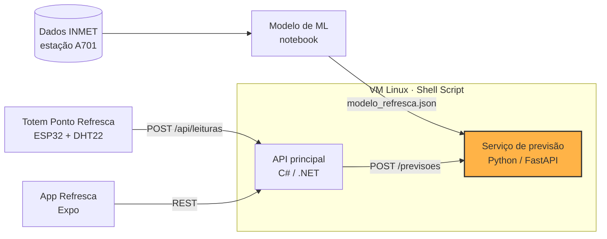

<details>
<summary><b>📁 Estrutura interna do serviço (clique para abrir)</b></summary>

```
app/
  main.py              # cria o FastAPI, registra rotas e tratamento de erros
  config.py            # variáveis de ambiente
  database.py          # engine e sessão SQLAlchemy
  schemas.py           # contratos JSON (Pydantic) e validações de entrada
  errors.py            # exceções de negócio
  deps.py              # injeção de dependências
  domain/              # entidade Previsao e regras de calor (índice NOAA, níveis)
  repositories/        # acesso ao banco
  services/            # caso de uso: prever, consultar
  ml/preditor.py       # ModeloXGBoost (modelo treinado) e HeuristicaCalor (linha de base)
  ml/preparar_variaveis.py  # cópia do repositório de ML: monta as 26 variáveis a partir de 3 dias
  routers/             # /previsoes e /health
migrations/            # Alembic: 0001 cria a tabela, 0002 o índice por data, 0003 guarda os 3 dias de entrada
modelos/               # modelo_refresca.json e metadados.json, copiados do repositório de ML
tests/                 # pytest
docs/                  # roteiro de testes, checklist, evidências
```

</details>

---

## 🔗 Repositórios da Refresca

| Parte | Disciplina | Repositório | Responsável |
| --- | --- | --- | --- |
| Totem (Wokwi) | Physical Computing: IOT & IOB | [link do Wokwi] | [Nome] |
| API principal | C# Software Development | https://github.com/danilowendler/gs-c- | Italo Caliari Silva |
| **Serviço de previsão** | **SOA e Web Services** | **https://github.com/danilowendler/gs-soa** | **Italo Caliari Silva** |
| Modelo de ML | Inteligência Artificial & Machine Learning | [link] | Danilo Gronski Wendler |
| App | Mobile Development & IOT | https://github.com/danilowendler/Global-Solution-Refresca---Mobile | Danilo Gronski Wendler |
| Infraestrutura Linux | Operating Systems | [link] | [Nome] |
| Segurança e PII | Cybersecurity | entregue em ZIP | [Nome] |
| Features e testes | Testing, Compliance & QA | [link do Azure Boards] | [Nome] |

---

## 🤝 Contratos entre as partes

| Serviço | URL local padrão | Variável de configuração |
| --- | --- | --- |
| API principal (C#) | `http://localhost:5000` | `REFRESCA_API_URL` |
| Serviço de previsão | `http://localhost:8000` | `REFRESCA_PREVISAO_URL` |

**Níveis do índice de calor** (faixas da NOAA, usadas pelo totem, pela API e pelo app):

| Nível | Índice de calor | Cor no totem |
| --- | --- | --- |
| `normal` | abaixo de 27 °C | 🟢 verde |
| `atencao` | de 27 °C até abaixo de 32 °C | 🟡 amarelo |
| `perigo` | a partir de 32 °C | 🔴 vermelho |

### Totem → API: `POST /api/leituras`

```json
{
  "totemId": "TOT-001",
  "temperatura": 33.4,
  "umidade": 48.0,
  "indiceCalor": 35.1,
  "nivel": "perigo",
  "medidoEm": "2026-11-19T14:00:00-03:00"
}
```

### App → API

| Método | Rota | Uso no app |
| --- | --- | --- |
| `GET` | `/api/alertas/hoje` | Alerta do dia na tela inicial |
| `GET` | `/api/pontos` | Mapa de Pontos Refresca, com a última leitura de cada totem |
| `GET` | `/api/pontos/{id}` | Detalhe de um ponto |
| `POST` | `/api/pausas` | Registrar pausa de hidratação |
| `GET` | `/api/trabalhadores/{id}/pausas` | Histórico de pausas |

Exemplo de ponto em `GET /api/pontos`:

```json
{
  "id": 1,
  "nome": "Padaria Exemplo",
  "latitude": -23.5890,
  "longitude": -46.6340,
  "temAgua": true,
  "temSombra": true,
  "temBanheiro": false,
  "ultimaLeitura": { "indiceCalor": 35.1, "nivel": "perigo", "medidoEm": "2026-11-19T14:00:00-03:00" }
}
```

### ⭐ API → Serviço de previsão: `POST /previsoes` (esta parte)

Requisição (resumo diário de anteontem, ontem e hoje; a previsão é para o dia seguinte):

```json
{
  "dataPrevista": "2026-11-20",
  "dias": [
    { "dia": "2026-11-17", "tempMax": 30.1, "tempMin": 18.2, "tempMedia": 23.5, "umidMedia": 62.0, "umidMin": 38.0, "indiceCalorMax": 30.8, "pressaoMedia": 924.6, "radiacaoTotal": 21500, "precipTotal": 0.0, "ventoMedio": 2.0 },
    { "dia": "2026-11-18", "tempMax": 31.8, "tempMin": 19.0, "tempMedia": 24.6, "umidMedia": 58.0, "umidMin": 35.0, "indiceCalorMax": 32.4, "pressaoMedia": 923.9, "radiacaoTotal": 23100, "precipTotal": 0.0, "ventoMedio": 1.8 },
    { "dia": "2026-11-19", "tempMax": 33.0, "tempMin": 19.8, "tempMedia": 25.4, "umidMedia": 55.0, "umidMin": 31.0, "indiceCalorMax": 33.9, "pressaoMedia": 923.1, "radiacaoTotal": 24000, "precipTotal": 0.0, "ventoMedio": 2.1 }
  ]
}
```

Resposta (`201 Created`):

```json
{
  "id": 42,
  "dataPrevista": "2026-11-20",
  "probabilidade": 0.6856,
  "perigoso": true,
  "versaoModelo": "xgboost-1.0"
}
```

Além do contrato acima, o serviço oferece consultas que não alteram o contrato:

| Método | Rota | O que faz |
| --- | --- | --- |
| `POST` | `/previsoes` | Calcula, grava e devolve a previsão (`201`) |
| `GET` | `/previsoes` | Lista previsões, mais recentes primeiro (filtros `data`, `limite`, `deslocamento`) |
| `GET` | `/previsoes/{id}` | Busca uma previsão por id |
| `GET` | `/previsoes/data/{AAAA-MM-DD}` | Última previsão registrada para o dia |
| `GET` | `/health` | Verifica o serviço e o banco |

Erros de validação voltam como `422`; id ou data sem previsão voltam como `404` com `{"erro": "nao_encontrada", "detalhe": "..."}`.

**Validações de entrada:** exatamente 3 dias, consecutivos e terminando na véspera da `dataPrevista` (podem vir em qualquer ordem); temperaturas entre -10 e 50 °C, mínima não pode superar a máxima; umidade de 0 a 100 %; pressão de 800 a 1.100 mB; vento de 0 a 60 m/s; chuva e radiação não negativas.

---

## 🧰 Tecnologias

<p>
  
  
  
  
  
  
  
</p>

- Python 3.12 e FastAPI (REST e documentação OpenAPI/Swagger automática)
- SQLAlchemy 2.0 (ORM) e SQLite (banco padrão, trocável por variável de ambiente)
- Alembic (migrações versionadas)
- Pydantic v2 (contratos e validação)
- pytest e httpx (testes automatizados)
- XGBoost 3.4.1, pandas e NumPy (modelo treinado no repositório de ML, em versões fixas)

---

## 🚀 Como rodar

### Pré-requisitos

- Python 3.12 ou superior (exigência do xgboost 3.4)

### Passos

```bash
git clone https://github.com/danilowendler/gs-soa.git
cd gs-soa

python -m venv .venv
source .venv/bin/activate          # Windows: .venv\Scripts\activate
pip install -r requirements-dev.txt

cp .env.example .env               # Windows: copy .env.example .env
alembic upgrade head               # cria o banco e a tabela 'previsoes'
uvicorn app.main:app --port 8000   # sobe o serviço em http://localhost:8000
```

> Na VM Linux, o script `scripts/start.sh` faz a migração e sobe o serviço de uma vez (serve como `ExecStart` de uma unit do systemd).

### Configuração

| Variável | Exemplo | Para quê |
| --- | --- | --- |
| `REFRESCA_PREVISAO_DB_URL` | `sqlite:///./refresca_previsao.db` | Banco de dados (qualquer URL SQLAlchemy) |
| `REFRESCA_MODELO_PATH` | `modelos/modelo_refresca.json` | Modelo treinado de ML. Vazio = usa a heurística |
| `REFRESCA_METADADOS_PATH` | *(vazio)* | Metadados do modelo. Vazio = `metadados.json` na pasta do modelo |
| `REFRESCA_LIMIAR_PERIGO` | *(vazio)* | Probabilidade a partir da qual `perigoso` é `true`. Vazio = limiar do notebook de ML (0,46), ou 0,5 na heurística |

### 🤖 Integração com o modelo de ML

O serviço usa o modelo **XGBoost treinado no repositório de IA/ML** com dados horários reais do INMET (estação A701, 2019 a 2025):

- `modelos/modelo_refresca.json`: o modelo no formato nativo do XGBoost (não depende do scikit-learn);
- `modelos/metadados.json`: ordem das 26 variáveis, limiar do alerta (0,46), versões e métricas do treino;
- `app/ml/preparar_variaveis.py`: cópia do módulo do repositório de ML que monta as 26 variáveis a partir dos 3 dias. O notebook de ML confere que esse módulo calcula exatamente as mesmas variáveis do treino.

**Versões fixas:** o mesmo arquivo de modelo dá probabilidades diferentes em versões diferentes do XGBoost (o mesmo dia quente dá 0,70 no 3.4.1 e 0,90 no 3.0.5). Por isso o `requirements.txt` fixa o `xgboost==3.4.1`, e o serviço se recusa a carregar o modelo se a versão instalada for outra.

Sem `REFRESCA_MODELO_PATH`, o serviço usa uma **heurística** de linha de base (`versaoModelo: "heuristica-1.0"`): compara o índice de calor máximo de hoje com o limite de perigo de 32 °C por uma curva sigmoide. Ela não é um modelo treinado.

---

## 📖 Documentação dos endpoints

Com a aplicação rodando:

- **Swagger UI:** http://localhost:8000/docs
- **ReDoc:** http://localhost:8000/redoc
- **OpenAPI (JSON):** http://localhost:8000/openapi.json

Exemplo rápido:

```bash
curl -X POST http://localhost:8000/previsoes \
  -H "Content-Type: application/json" \
  -d @docs/exemplo_previsao.json
```

<p align="center">
  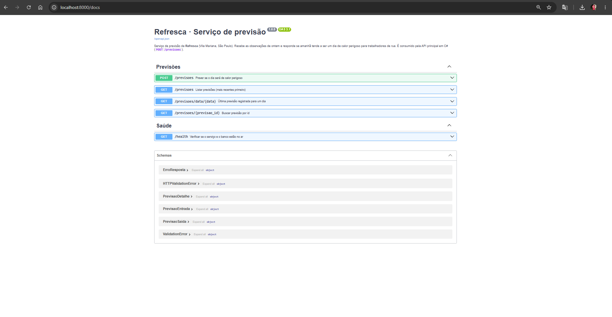
</p>

---

## 🧪 Testes

```bash
pytest -v
```

Os testes usam um banco SQLite em memória e cobrem: contrato do `POST`, limiar de perigo (inclusive o limiar vindo do modelo de ML), validações (`422`), consulta por id e por data, `404`, listagem com filtro e paginação, `/health`, índice de calor contra a tabela da NOAA, as 26 variáveis do modelo, carregamento de um modelo XGBoost e o modelo real separando dia quente de dia ameno. O roteiro completo está em [`docs/ROTEIRO_TESTES.md`](docs/ROTEIRO_TESTES.md).

<p align="center">
  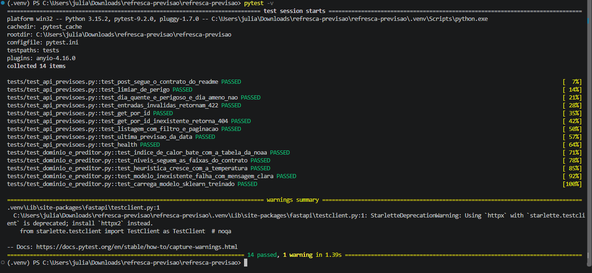
</p>

---

## 📸 Evidências

<details>
<summary><b>Clique para ver os prints da execução (migrações, API, banco e testes)</b></summary>

<br>

<table>
  <tr>
    <td align="center" width="50%"><b>01 · Migrações aplicadas</b><br>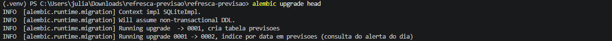</td>
    <td align="center" width="50%"><b>02 · Histórico das migrações</b><br></td>
  </tr>
  <tr>
    <td align="center"><b>03 · Schema do banco</b><br>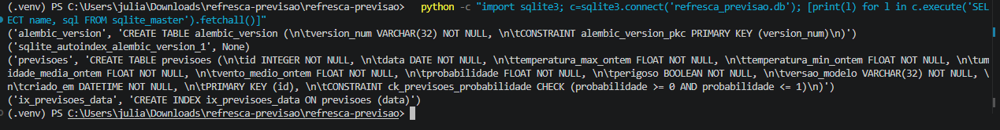</td>
    <td align="center"><b>04 · Servidor no ar</b><br></td>
  </tr>
  <tr>
    <td align="center"><b>05 · Swagger: rotas</b><br></td>
    <td align="center"><b>05 · Swagger: POST documentado</b><br>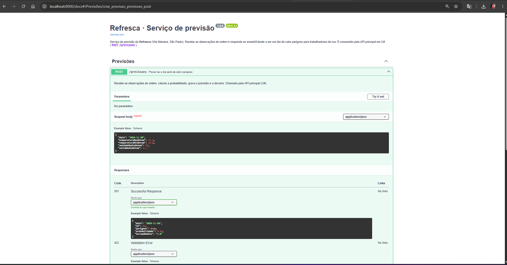</td>
  </tr>
  <tr>
    <td align="center"><b>06 · POST com resposta 201</b><br>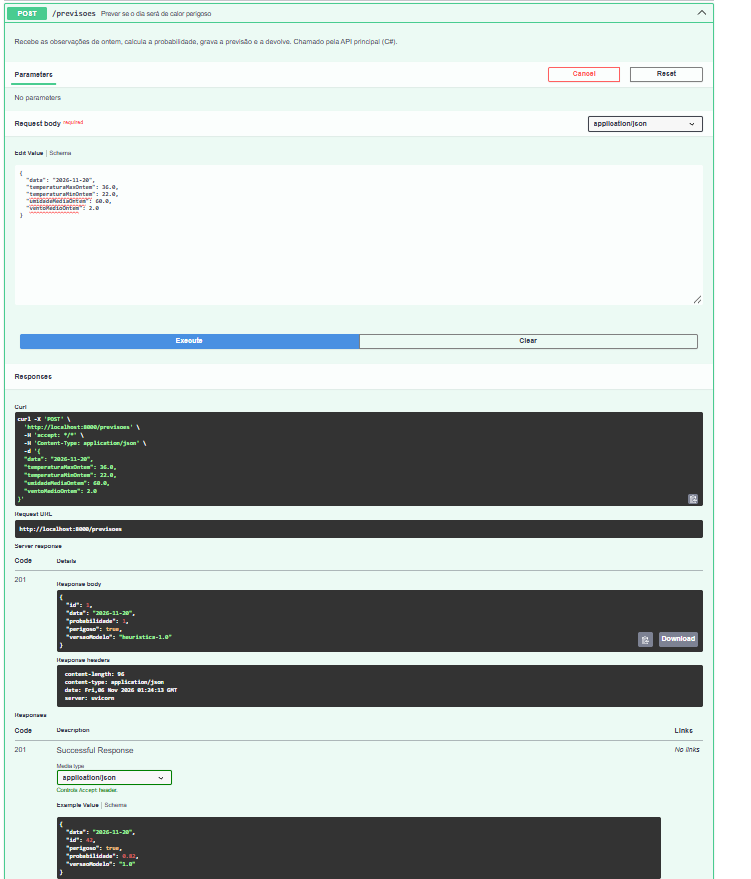</td>
    <td align="center"><b>07 · POST dia quente (201)</b><br>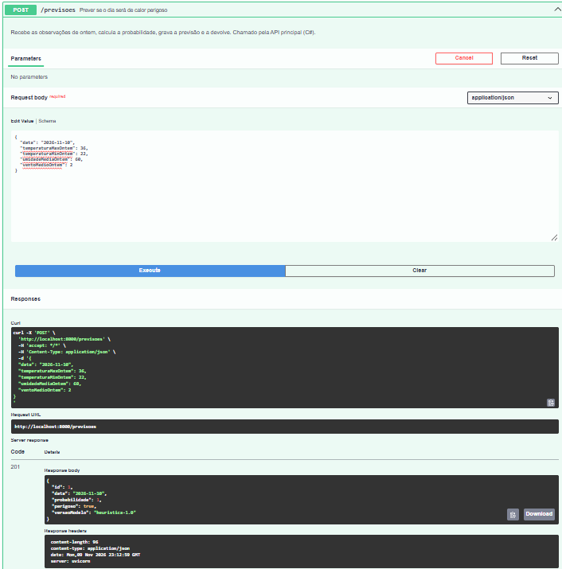</td>
  </tr>
  <tr>
    <td align="center"><b>08 · POST dia ameno (201)</b><br>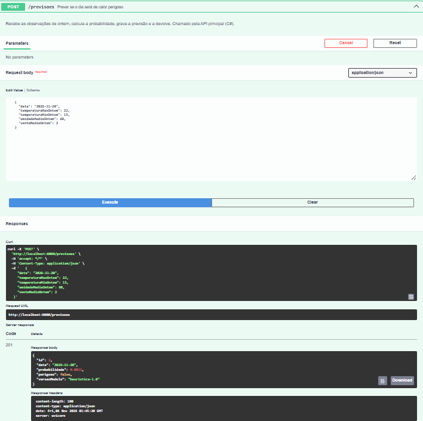</td>
    <td align="center"><b>09 · Validação: umidade (422)</b><br>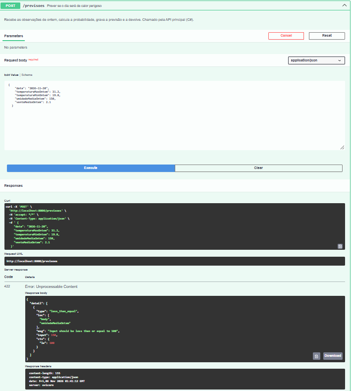</td>
  </tr>
  <tr>
    <td align="center"><b>10 · Validação: mínima &gt; máxima (422)</b><br>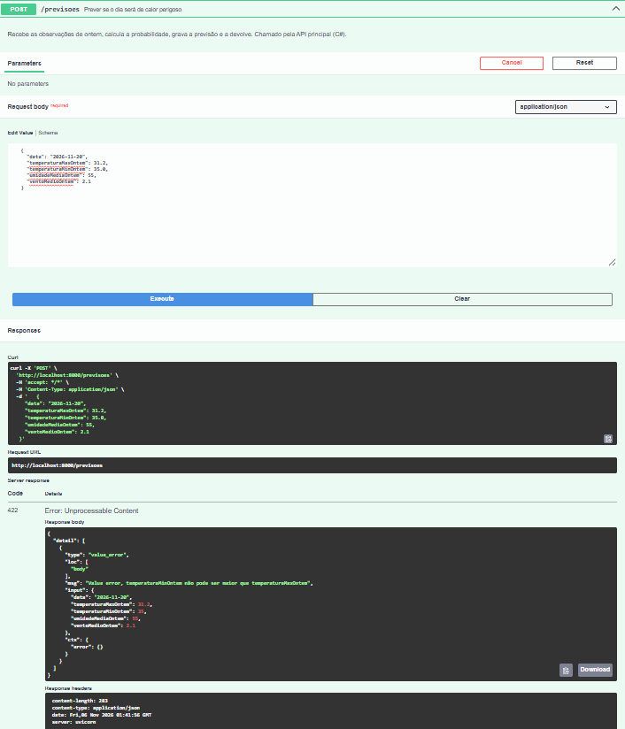</td>
    <td align="center"><b>11 · GET por ID (200)</b><br>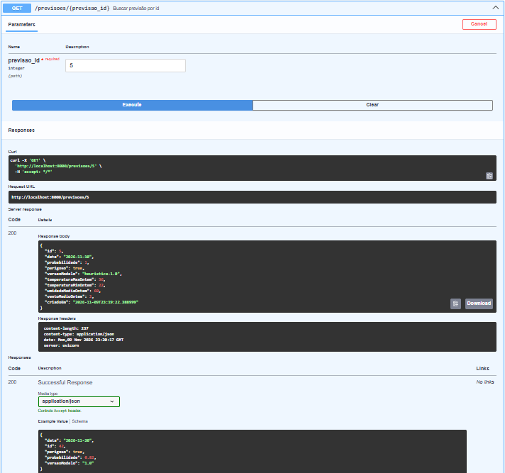</td>
  </tr>
  <tr>
    <td align="center"><b>12 · Id inexistente (404)</b><br>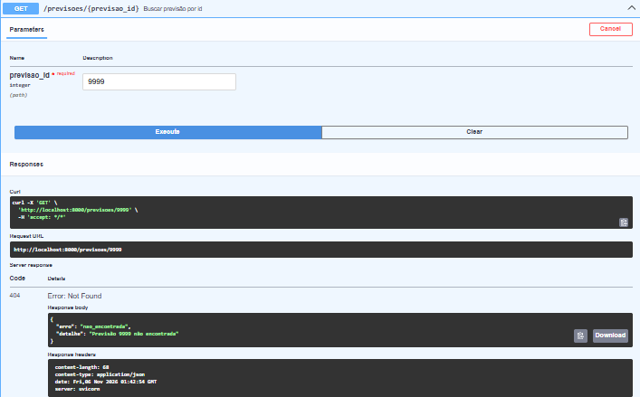</td>
    <td align="center"><b>13 · Listagem com filtro</b><br>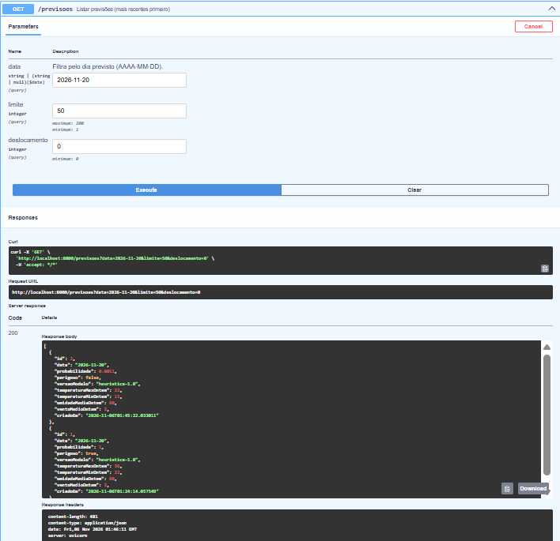</td>
  </tr>
  <tr>
    <td align="center"><b>14 · Última previsão do dia</b><br>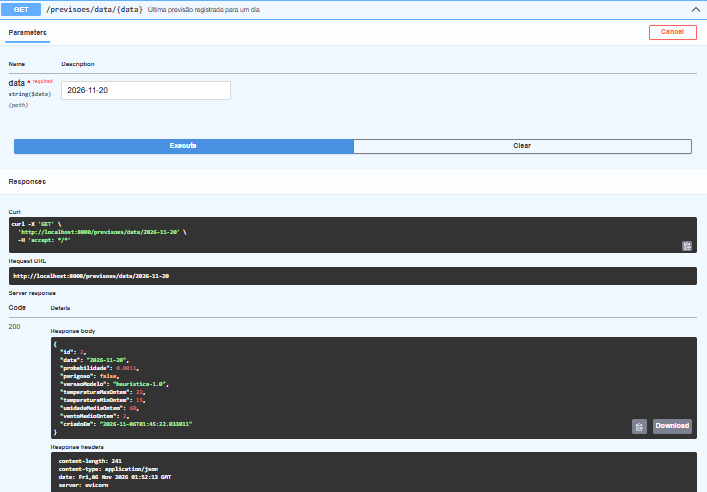</td>
    <td align="center"><b>15 · Saúde do serviço</b><br>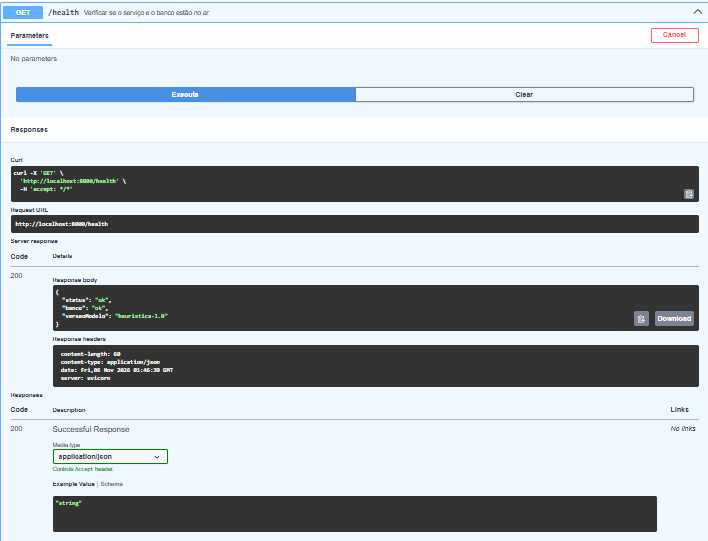</td>
  </tr>
  <tr>
    <td align="center"><b>16 · Registros gravados no banco</b><br>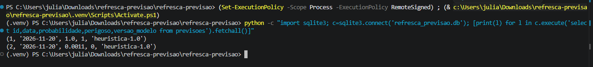</td>
    <td align="center"><b>17 · Persistência após reiniciar</b><br>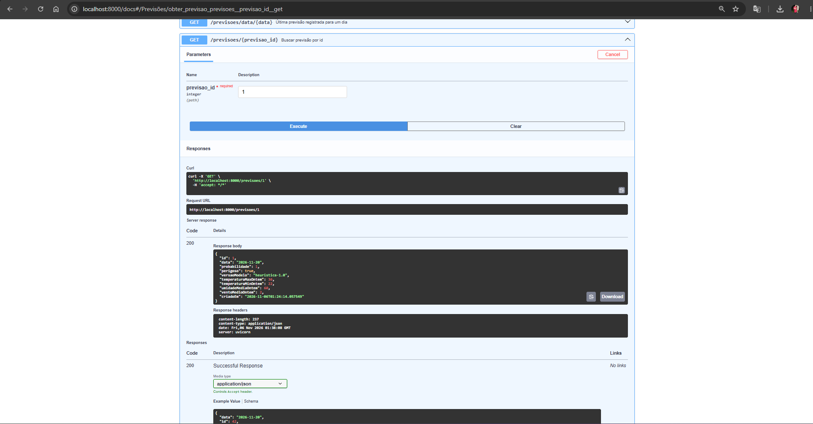</td>
  </tr>
  <tr>
    <td align="center"><b>18 · Testes automatizados</b><br></td>
    <td align="center"><b>19 · Downgrade e upgrade das migrações</b><br>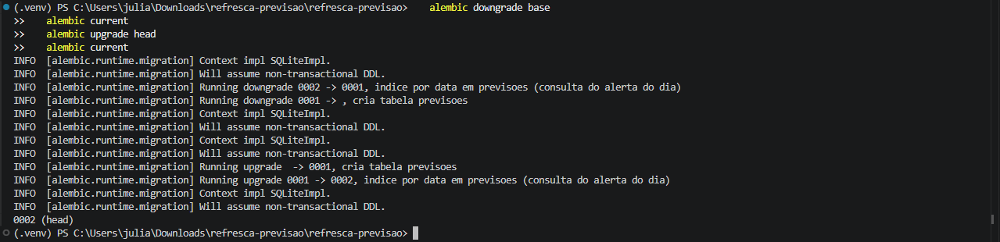</td>
  </tr>
</table>

</details>

As evidências estão em [`docs/evidencias/`](docs/evidencias/). Vídeo: não exigido pela disciplina de SOA.

---

## ✅ Entregáveis da disciplina

Critérios de avaliação (10,0 pontos). O mapa de requisitos para arquivos está em [`docs/CHECKLIST_E_AUDITORIA.md`](docs/CHECKLIST_E_AUDITORIA.md).

- [x] **Estruturação do domínio (3,0):** `app/domain`, `app/services`, `app/repositories`, `app/schemas.py`
- [x] **Conexão com banco de dados (3,0):** `app/database.py`, `app/repositories`
- [x] **Migrações (1,5):** `migrations/` (Alembic, 3 versões com downgrade)
- [x] **Documentação automática (1,5):** Swagger em `/docs`
- [x] **Testes automatizados (1,0):** `tests/` (18 testes)

---

## 🗂️ Dados

- **Clima:** dados históricos horários do INMET, estação automática A701 (São Paulo, Mirante de Santana), https://portal.inmet.gov.br/dadoshistoricos
- **Pontos Refresca, trabalhadores e leituras:** dados simulados, criados pela equipe. Nenhum dado pessoal real é usado no projeto.
- **Serviço de previsão:** guarda apenas observações meteorológicas e o resultado da previsão. Não guarda nenhum dado pessoal.

## 🤖 Uso de IA

A IA foi usada como copiloto para aprender e revisar. Os prompts estão registrados em [`prompts.md`](prompts.md).

---

## 👥 Integrantes

| Nome | RM |
| --- | --- |
| Italo Caliari Silva | RM554758 |
| Júlio César Ruiz Zequin | RM554676 |
| Danilo Gronski Wendler | RM556602 |
| Pedro Henrique Muzel Santos | RM555983 |
| Vitor Montemor Ismael | RM556027 |

<div align="center">
<sub>Refresca · Global Solution 2026.2 · FIAP</sub>
</div>
